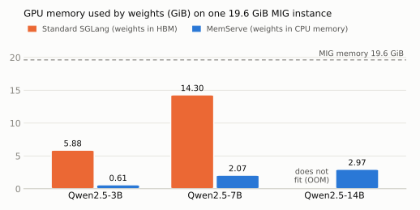
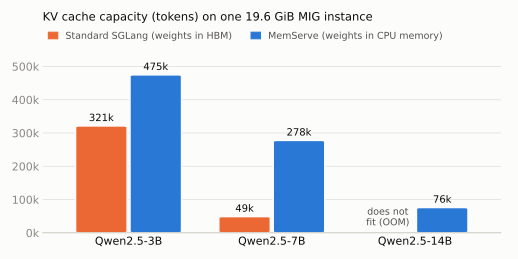
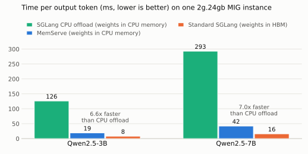

# MemServe

MemServe serves multiple models across NVIDIA MIG instances using CPU-resident weights with a customized [SGLang](https://github.com/PhysFlow/sglang) inference engine.

## News

- [2026/10] Initial release of MemServe.

## Key Features

- Models beyond MIG memory: Keep weights in pinned CPU memory and read them during inference with HybridGEMM.
- Adaptive execution: Tune the HybridGEMM ratio online using MIG HBM and shared host-link utilization.
- On-demand model serving: Place models as requests arrive, queue requests when MIG instances are busy, and evict idle models in LRU order.
- Automatic startup configuration: Choose the initial HybridGEMM ratio and prefill chunk size for each model and MIG instance.

## Architecture

The system consists of two packages:

| Package | Role |
| --- | --- |
| `control_plane` | OpenAI-compatible gateway that discovers MIG instances, places models on demand, queues requests when all instances are busy, and evicts idle models in LRU order. It manages one SGLang worker per MIG instance. |
| `runtime` | Runs inside each SGLang worker. It reads the MIG instance's HBM utilization and shared host-link utilization through NVML GPM, then adjusts the HybridGEMM ratio online. |

The inference engine is a customized version of `PhysFlow/sglang` and is installed separately.

HybridGEMM, the SM90 GEMM kernel that keeps weights in CPU memory and splits computation between Sym and Asym paths according to the ratio, is not open source yet.

For details, see:

- [System design](docs/system.md)
- [Control plane](docs/control_plane.md)
- [Runtime tuning](docs/runtime.md)
- [SGLang integration](docs/sglang.md)

## Experimental Results

### Memory

Measured on an NVIDIA H800 PCIe split into 2g.20gb MIG instances (19.6 GiB HBM and 30 SMs each), serving Qwen2.5 3B, 7B and 14B in BF16. Standard SGLang keeps the weights in HBM; MemServe keeps the weights in CPU memory.

#### Serve models larger than the MIG instance



- Qwen2.5-14B (28.4 GB of weights) cannot start on a 19.6 GiB instance with standard SGLang. MemServe serves it with 2.97 GiB of HBM.
- Weights take 7 to 10 times less HBM: 5.88 to 0.61 GiB for 3B, 14.30 to 2.07 GiB for 7B.

#### Up to 5.7x more KV cache



The HBM freed from weights goes to the KV cache: Qwen2.5-7B holds 277,792 tokens instead of 48,928 (5.7x), Qwen2.5-3B holds 1.5x more, and Qwen2.5-14B gets 76,116 tokens on an instance where standard SGLang cannot run at all.

### Accuracy

Measured on the same H800 PCIe 2g.20gb MIG instances, serving Qwen2.5 3B and 7B in BF16 with greedy decoding.

Keeping weights in CPU memory does not measurably change accuracy. On the full GSM8K test set (1,319 questions), standard SGLang and MemServe both score 0.789 for Qwen2.5-3B, and score 0.866 and 0.870 for Qwen2.5-7B.

The Sym path matches PyTorch BF16 exactly. The Asym path adds up K in blocks of 256 and rounds each partial sum to BF16, so its error grows with K: against an FP32 reference, the relative L2 error is 0.50% at K = 3584 and 1.04% at K = 18944, compared with 0.17% for PyTorch BF16.

### Speed

Measured on an NVIDIA GH200 split into 2g.24gb MIG instances (23 GiB HBM and 32 SMs each), serving Qwen2.5 3B and 7B in BF16 on one instance, with 128 input tokens and 64 output tokens per request. SGLang CPU offload and MemServe keep the weights in CPU memory; standard SGLang keeps them in HBM. MemServe runs with the HybridGEMM ratio fixed at 0.

#### 6.6 to 7x faster than SGLang CPU offload



- Time per output token drops from 293 to 42 ms for Qwen2.5-7B and from 126 to 19 ms for Qwen2.5-3B.
- At 16 concurrent requests, MemServe serves 6.6 times the throughput for 7B (347 vs 52 tokens/s) and 6.0 times for 3B (728 vs 121 tokens/s).
- SGLang CPU offload copies the weights into HBM with the copy engine, about 47 GB/s on this instance. MemServe reads them directly over NVLink-C2C.
- With the ratio fixed at 1 (all Asym), time per output token is 24 ms for 3B and 43 ms for 7B, still 5.3 to 6.8 times faster than SGLang CPU offload.

#### Fast enough for interactive serving

| Model | Time to first token | Time per output token | Tokens per second per request |
| --- | --- | --- | --- |
| Qwen2.5-3B | 54 ms | 19 ms | 53 |
| Qwen2.5-7B | 91 ms | 42 ms | 24 |

#### Close to the NVLink-C2C limit

Compared with keeping the weights in HBM, time per output token is 2.4 to 2.6 times higher: 19 vs 8 ms for 3B, 42 vs 16 ms for 7B. Every output token reads all weights, and on one instance HBM delivers 961 GB/s while NVLink-C2C delivers 356 GB/s, a 2.7x gap. The difference comes from the link: HybridGEMM reads the weights at about 90% of the NVLink-C2C limit.

### Cold Start

Measured on the same GH200 2g.24gb MIG instances, serving Qwen2.5 3B, 7B and 14B in BF16. Each trial clears the OS page cache, starts a new SGLang worker, waits until it is healthy, and sends one request with 8 output tokens; the numbers are the median of three trials. Both backends run with `--cuda-graph-max-bs 32`.

#### Start models larger than the instance, small models at near-native speed

| Model | Standard SGLang | MemServe |
| --- | --- | --- |
| Qwen2.5-3B | 22.2 s | 22.7 s |
| Qwen2.5-7B | 24.1 s | 26.1 s |
| Qwen2.5-14B | out of memory | 42.7 s |

- Qwen2.5-14B cannot start on a 23 GiB instance with standard SGLang. MemServe starts it and answers the first request in 43 s.
- For models that fit in HBM, MemServe starts within 8% of standard SGLang. Loading the weights takes about as long, 1.9 vs 2.2 s for 3B and 4.9 vs 4.7 s for 7B: MemServe pins them in CPU memory instead of copying them into HBM.
- Steps that read the weights over the host link stay short on NVLink-C2C: capturing CUDA graphs takes 2.1 to 3.3 s and the first request 0.6 to 1.1 s.

## Requirements

- Linux with an NVIDIA Hopper GPU (SM90) and at least one available MIG instance, tested on H800 PCIe (x86_64) and GH200 (aarch64)
- NVIDIA driver 580+, CUDA Toolkit 13.x, Python 3.10, [uv](https://docs.astral.sh/uv/), Git, a C++ compiler, Rust/Cargo, and protoc
- With driver 570, install the CUDA forward compatibility package (cuda-compat-13-0) and put its compat directory first in LD_LIBRARY_PATH

## Install

Clone MemServe and the matching SGLang revision into the same directory:

```bash
git clone https://github.com/PhysFlow/ServerlessLLMonSuperchips.git
git clone https://github.com/PhysFlow/sglang.git
git -C sglang checkout ddca8cd6c81dab414914df82b441548c315f64d9
cd ServerlessLLMonSuperchips
uv sync --locked --inexact --all-packages --all-groups
source .venv/bin/activate
uv pip install --prerelease=allow --reinstall-package sglang -e ../sglang/python
```

Keep `--inexact` on later `uv sync` runs so uv does not remove the separately installed SGLang.

## Run

The example configuration serves TinyLlama and two Qwen models. Start the gateway in one terminal:

```bash
source .venv/bin/activate
python -m memserve_control_plane --config control-plane.example.json
```

Send a request from another terminal:

```bash
curl --fail-with-body --max-time 660 http://127.0.0.1:8100/v1/chat/completions \
  -H 'Content-Type: application/json' \
  -d '{"model":"tinyllama","messages":[{"role":"user","content":"Say hello briefly."}],"max_tokens":32}'
```

The first request downloads and loads the model, which can take several minutes. To serve another model, edit [`control-plane.example.json`](control-plane.example.json); the request's `model` must match its `model_id`.

## Testing

```bash
source .venv/bin/activate
python -m pytest -q control_plane/tests
export CUDA_VISIBLE_DEVICES=MIG-replace-with-your-instance-UUID
python -m pytest -q runtime/tests
```

## Contributing

See [CONTRIBUTING.md](CONTRIBUTING.md).

Licensed under [Apache 2.0](LICENSE).
