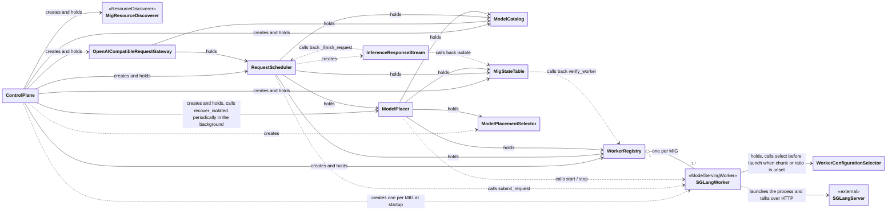

# Control Plane

## Data types

MigResourceCapacity, WorkerExecutionConfiguration, WorkerLifecycleState, WorkerStatus, ChatMessage, ModelInferenceRequest, ModelPlacementDecision, ModelPlacement, ModelPlacementSnapshot, ControlPlaneConfig, ModelConfig, EngineConfig, GatewayConfig

## Classes

### ResourceDiscoverer (Protocol)

```python
discover() -> tuple[MigResourceCapacity, ...]
```

### MigResourceDiscoverer

```python
discover() -> tuple[MigResourceCapacity, ...]
```

### ModelCatalog

```python
get_configuration(model_id) -> WorkerExecutionConfiguration
mark_failed(model_id, reason) -> None
mark_started(model_id) -> None
startup_retry_delay(model_id) -> float
require_schedulable(model_id) -> WorkerExecutionConfiguration
```

### WorkerRegistry

```python
get_worker(instance_id) -> ModelServingWorker
stop_all() -> None
verify_worker(instance_id) -> ContextManager[WorkerStatus | None]
```

### MigStateTable

```python
list_mig_resources() -> tuple[MigResourceCapacity, ...]
snapshot_placements() -> ModelPlacementSnapshot
observe(snapshot) -> tuple[dict[str, WorkerStatus], set[str]]
isolate(instance_id) -> None
recoverable() -> tuple[str, ...]
release_isolated(instance_id) -> None
reserve_placement(decision) -> str
commit_placement(instance_id) -> None
rollback_placement(instance_id) -> None
mark_request_started(instance_id, request_id) -> None
mark_request_finished(instance_id, request_id) -> None
```

### ModelPlacementSelector

```python
select_placement(model_id, resources, snapshot, statuses, verified_empty) -> ModelPlacementDecision
```

### ModelPlacer

```python
is_loading(model_id) -> bool
place(model_id) -> ModelPlacementDecision | None
load(decision) -> None
recover_isolated() -> None
```

### ModelServingWorker (Protocol)

```python
start(configuration) -> None
stop() -> None
get_status() -> WorkerStatus
verify_status() -> ContextManager[WorkerStatus]
submit_request(request) -> Iterator[str]
```

### SGLangWorker

```python
start(configuration) -> None
stop() -> None
get_status() -> WorkerStatus
verify_status() -> ContextManager[WorkerStatus]
submit_request(request) -> Iterator[str]
```

### WorkerConfigurationSelector

```python
select(model_path, instance_id) -> tuple[int, float]
```

### RequestScheduler

```python
async schedule_and_submit(request: ModelInferenceRequest) -> InferenceResponseStream
async provision(model_id) -> None
```

### InferenceResponseStream

```python
__aiter__() / async __anext__() -> object
async aclose() -> None
async __aenter__() / __aexit__()
```

### OpenAICompatibleRequestGateway

```python
parse_request(payload, *, request_id=None) -> ModelInferenceRequest
async schedule(request) -> InferenceResponseStream
async encode_stream(request, stream, *, kind="chat") -> AsyncIterator[bytes]
async encode_response(request, stream, *, kind="chat") -> dict
error_response(error) -> tuple[int, dict]
internal_error_response() -> tuple[int, dict]
async __call__(scope, receive, send) -> None
```

### ControlPlane

```python
gateway -> OpenAICompatibleRequestGateway
placements -> MigStateTable
workers -> WorkerRegistry
async start() -> None
async run() -> None
async shutdown() -> None
```

## Functions

### config.py

```python
load_config(path) -> ControlPlaneConfig
```

### engine.py

```python
build_workers(engine, instance_ids, *, port_check=None) -> dict[str, SGLangWorker]
check_hybrid_gemm_compatibility(models, load_model_config=None) -> None
```

### inference_response_stream.py

```python
async settle(task) -> object
```

### server.py

```python
async uvicorn_runner(app, host, port) -> None
```

### __main__.py

```python
main(argv=None) -> int
```

## Relations


