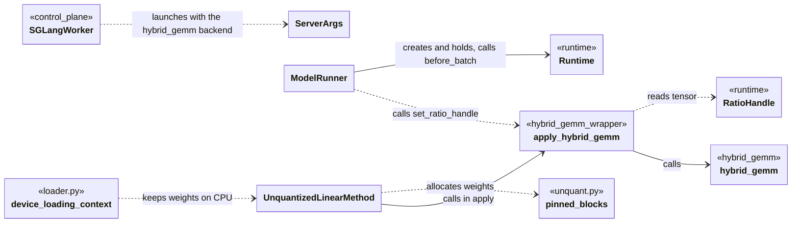

# SGLang

MemServe runs a customized SGLang: PhysFlow/sglang, branch memserve, based on upstream SGLang v0.5.12. This document covers only the changes MemServe depends on.

## Data types

ServerArgs

## Classes

### ServerArgs

```python
linear_gemm_backend -> str
hybrid_gemm_asym_ratio -> float
```

### ModelRunner

```python
memserve_runtime -> Runtime | None
forward(forward_batch, skip_attn_backend_init=False, pp_proxy_tensors=None, reinit_attn_backend=False, split_forward_count=1) -> ModelRunnerOutput
```

### UnquantizedLinearMethod

```python
create_weights(layer, input_size_per_partition, output_partition_sizes, input_size, output_size, params_dtype, **extra_weight_attrs) -> None
process_weights_after_loading(layer) -> None
apply(layer, x, bias=None) -> torch.Tensor
```

## Functions

### layers/hybrid_gemm_wrapper/entrypoint.py

```python
set_ratio_handle(handle) -> None
apply_hybrid_gemm(x, weight, bias=None) -> torch.Tensor
```

### layers/quantization/unquant.py

```python
_allocate_pinned_block(num_bytes) -> torch.Tensor
_empty_pinned_host_tensor(shape, dtype) -> torch.Tensor
```

### model_loader/loader.py

```python
device_loading_context(module, target_device) -> ContextManager[None]
```

## Relations


