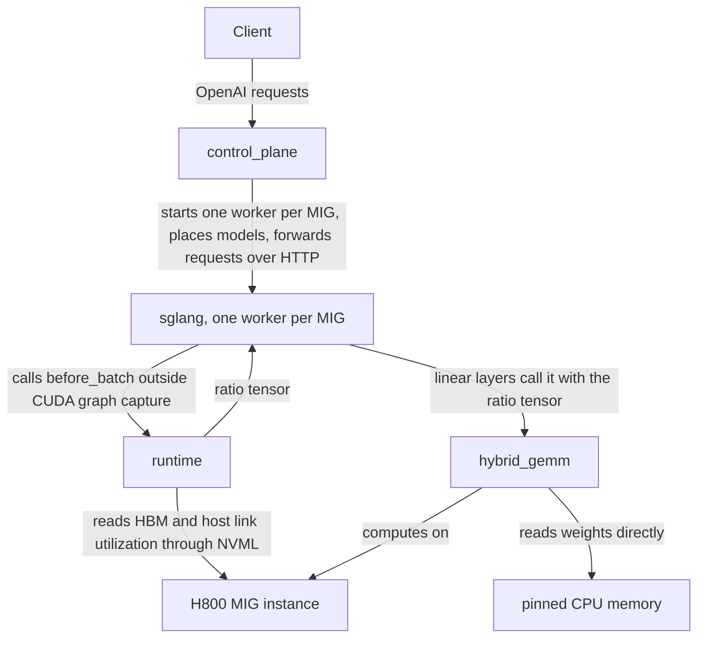

# System

## Components

| Component | Process | Document |
|---|---|---|
| control_plane | one process per machine | [control_plane.md](control_plane.md) |
| sglang | one worker process per MIG instance, customized PhysFlow/sglang | [sglang.md](sglang.md) |
| runtime | inside every sglang worker process | [runtime.md](runtime.md) |
| hybrid_gemm | inside every sglang worker process | not open source yet |

## Relations

